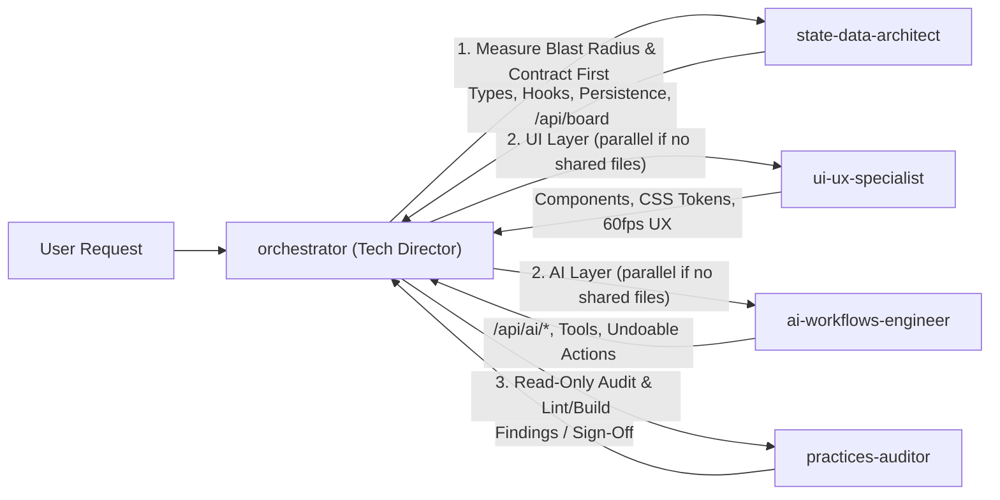

# CromaKanban

Interactive multi-project Kanban board with customizable aesthetics (**Psychedelic**, **Dark**, and **Light**), **Gemini**-powered smart assistance via text and voice, local JSON database persistence on the server, and an adaptive experience between **desktop mode** (default) and **mobile mode**.

---

## Project Purpose

**CromaKanban** is designed to organize ideas, tasks, and projects visually and quickly without relying on external services or complex databases:

- Centralize multiple independent project boards in a single workspace.
- Manipulate cards and columns smoothly with mouse/keyboard (60fps drag & drop, shortcuts, and horizontal panning) as well as natural language commands or voice dictation.
- Keep all projects, columns, cards, and visual preferences stored locally in the server's `./data/cromakanban-db.json` file.

---

## AI Agent Architecture & Workflow (`.agents/`)

Alongside [`AGENTS.md`](AGENTS.md), the [`.agents/`](.agents) directory configures a layered multi-agent development workflow tailored to **CromaKanban** (React + TypeScript + Tailwind + Express local-first architecture). It defines specialized roles, strict file-path boundaries, and execution skills so changes respect Single Source of Truth (SSOT) and Separation of Concerns (SRP).

### Directory Structure

| Path | Purpose |
| :--- | :--- |
| [`.agents/agents/`](.agents/agents) | Role definitions, tool permissions, and scope boundaries for each specialized agent. |
| [`.agents/skills/`](.agents/skills) | Custom-agent authoring and governance guide ([`custom-agents`](.agents/skills/custom-agents/SKILL.md)). |

### How the Agents Work Together



### Agent Roles & Responsibilities

1. **[`orchestrator`](.agents/agents/orchestrator.md)** — *Technical Director (`mainAgent: true`, `subagent: false`)*
   - **What it does:** Receives any development request, runs read-only reconnaissance (`grep_search`, `find_by_name`, `view_file`, `git status -s`) to measure the actual blast radius across layers, presents a 3–8 line delegation plan, and coordinates the squad.
   - **How it operates:** **Never edits code** (has no file-editing tools). Enforces a contract-first order (`state-data-architect` → `ui-ux-specialist` / `ai-workflows-engineer` in parallel only if they do not share files like `App.tsx` or `server.ts` → `practices-auditor`), routes any `[BLOCKER]` or `[ROUTE/STATE RISK]` findings back to the owning agent via `send_message`, and only signs off once `npm run lint` and `npm run build` pass.

2. **[`state-data-architect`](.agents/agents/state-data-architect.md)** — *Local State & Data Architect*
   - **What it does:** Designs and implements domain models, client-side state flow, local API routes, and disk persistence (including Undo/Redo and saved-data migrations).
   - **Scope & rules:** Owns `src/types/`, `src/data/`, `src/hooks/`, `src/services/`, global state in `App.tsx`, `localStorage`, `./data/` atomic sequential-queue persistence, and `/api/board` routes in `server.ts`. Ensures surgical target-ID accuracy and runs `npm run lint` (`tsc --noEmit`) before reporting back.

3. **[`ui-ux-specialist`](.agents/agents/ui-ux-specialist.md)** — *UI/UX, Visual Systems & Fluid Interaction Specialist*
   - **What it does:** Builds and evolves views, modals, 60fps micro-interactions (`requestAnimationFrame`, `motion/react`), dual Desktop/Mobile ergonomics, and the multi-theme design system.
   - **Scope & rules:** Owns `src/components/`, `src/index.css` semantic CSS tokens (`psychedelic`, `dark`, `light`), and purely visual/interaction hooks. Never embeds server or persistence logic in components, avoids hardcoded theme hex colors, and validates props/types with `npm run lint`.

4. **[`ai-workflows-engineer`](.agents/agents/ai-workflows-engineer.md)** — *Applied AI & Multimodal Orchestration Engineer*
   - **What it does:** Owns the built-in intelligent copilot: `/api/ai/*` endpoints in `server.ts`, `FunctionDeclaration` tool definitions, `responseSchema` contracts, system prompts, voice transcription, and the client-side AI action dispatcher.
   - **Scope & rules:** Ensures exact project/column/card IDs in context snapshots and client-side validation, keeps AI mutations reversible via the Undo/Toast system, and runs `npm run lint` to verify backend ↔ frontend contract alignment.

5. **[`practices-auditor`](.agents/agents/practices-auditor.md)** — *Read-Only Architecture & Route Integrity Auditor*
   - **What it does:** Performs mandatory closing verification across all changes, classifying findings as `[BLOCKER]`, `[ROUTE/STATE RISK]`, or `[TECH DEBT]` with exact file/line references and concrete fixes.
   - **Scope & rules:** Strictly read-only (no write/edit tools). Audits the 4 pillars—strict route discipline (files, endpoints, state), SRP modularity, SSOT synchronization, and execution hygiene (cleanup of `requestAnimationFrame`/listeners/timers/audio streams, zero dead code)—and verifies `npm run lint` and `npm run build` without wasting time on cloud-security bureaucracy.

### Global Rules & Skills

- **Architecture & Route Rules ([`AGENTS.md`](AGENTS.md))**: Defines local-first boundaries, file-path ownership, atomic refactoring rules (no orphaned code or duplicate paths), and the mandatory delegation/audit workflow.
- **Custom Agents Skill ([`custom-agents`](.agents/skills/custom-agents/SKILL.md))**: Documents YAML frontmatter fields, least-privilege tool scoping, and how to invoke or author custom agents in Antigravity (`agy --agent orchestrator` or via the UI dropdown).

---

## Key Features

- **Multi-project**: Create, rename, switch, and delete independent projects, starting from a blank board or predefined templates (*Creative Studio & Festival*, *Software Product Sprint*, etc.).
- **Full Kanban Board**:
  - Columns with inline-editable titles, a 6-accent-color palette, and horizontal reordering.
  - Cards with title, description, category tag, priority (`high`, `medium`, `low`), due date, and interactive subtask checklist.
  - Smooth card dragging across columns and within the same column, plus horizontal panning and a quick column navigation bar.
- **Triple Visual Theme**:
  - **Psychedelic** (high contrast, neon accents, and animated backdrop).
  - **Dark** (clean dark slate surfaces).
  - **Light** (bright, clean aesthetic).
- **Summary View**: Analytics panel with overall progress metrics, per-column distribution, priorities, and completed checklist items.
- **Search and Filters**: Instant search by title/description/category and priority filtering.
- **Built-in AI Assistant (text and voice)**:
  - **AI Breakdown (`I`)**: Turns a goal or free-form list into 2 to 7 actionable cards with subtasks.
  - **Voice / Commands (`K`)**: Interprets natural-language instructions via text or microphone to create, move, update, or delete cards and columns, switch themes, or manage projects.
- **Undo Actions**: Toast notifications with an **Undo** button after deleting cards, columns, projects, or running AI actions.
- **Keyboard Shortcuts**:
  - `1`, `2`, `3`: Switch between Psychedelic, Dark, and Light themes.
  - `I`: Open *AI Breakdown*.
  - `K`: Open *AI Voice / Commands*.
  - `N`: Create new column.
  - `/`: Focus search bar.

---

## Changelog and Implemented Updates

### 1. Full-Stack Architecture and API Key Security (`server.ts`)
- **Express** server integrated with **Vite** in development (`tsx server.ts`) and static files in production (`npm run build` + `npm start`).
- Gemini calls via `@google/genai` run exclusively on the backend using the `GEMINI_API_KEY` environment variable, avoiding exposing credentials in the browser.

### 2. Natural-Language Text and Voice Interaction with AI
- `POST /api/ai/command` endpoint using `gemini-4-hydrogen` and *function calling* (`KANBAN_TOOLS`) to execute semantic actions on the current board state:
  - `deleteCards`, `moveCards`, `updateCards`, `createCards`
  - `createColumn`, `renameColumn`, `deleteColumn`
  - `createProject`, `switchProject`, `setTheme`
- `POST /api/ai/transcribe` endpoint using `gemini-3.5-transcribe` to transcribe voice recordings from `AiCommandModal`.
- `POST /api/ai/breakdown` endpoint to break down goals into structured cards.
- Improved command-application flow: upon confirming execution, the modal closes automatically and displays a toast with the summary of changes and an **Undo** option.

### 3. Multi-Project Support
- `KanbanProject` structure in `src/types/kanban.ts` with per-project columns, cards, and accent color.
- `ProjectsModal` component to create new projects (choosing color and base template), switch projects, rename, or delete with undo support.
- Project dropdown selector integrated into `WorkspaceToolbar` and also controllable via AI commands.

### 4. Persistent Database in Local JSON File
- `GET /api/board` and `PUT /api/board` endpoints in `server.ts` that read and write atomically (temp file + `rename` in a sequential queue) to `./data/cromakanban-db.json`.
- Automatic hydration on app load, `300 ms` debounced sync, `localStorage` backup, and `keepalive` save on `beforeunload` when closing or reloading the tab.

### 5. Mobile Optimization and Hybrid Card-Moving System
- General responsiveness improvements in `index.html`, `src/index.css`, and modals (`max-h-[92dvh]`, `16px` inputs on mobile to prevent iOS auto-zoom).
- **Quick menu on every card (`⋮` / `CardQuickMenuSheet`)**: Rendered at the root to prevent clipping inside column scroll containers; allows **Move Up / Down** within the column, moving to **Previous / Next** or picking any target column, **Edit**, **Delete**, and pinning to the bottom bar in mobile mode.
- **Fixed bottom thumb-zone bar (`MobileCardActionBar`)**: Quickly moves and reorders the selected card with large buttons (`↑`, `↓`, `←`, `→` and direct column picker), auto-scrolling the board when changing columns.
- **Enhanced touch dragging**:
  - `280 ms` long press on any card (with `8 px` tolerance so it doesn't interfere with normal scrolling, plus haptic vibration when supported).
  - Immediate drag from the grip handle (`⋮⋮`).
  - Temporary suspension of vertical column scroll and horizontal `scroll-snap` while dragging so cards can cross between columns smoothly.

### 6. Default Desktop Mode with Quick Switcher
- Added `LayoutMode` (`'desktop' | 'mobile'`) defaulting to **`desktop` (Desktop Mode)** persisted in `localStorage`.
- By default, the full header (`Board`, `Projects`, `Summary`, `Templates`, `Shortcuts`), full toolbar, `328 px` columns, and side navigation arrows are always shown, even in narrow windows or compact preview panes.
- Added a button in `Header` to toggle between **Mobile** and **Desktop** in one click.

---

## Project Structure

```text
├── server.ts                          # Express server, /api/board and /api/ai/* routes
├── index.html                         # HTML entry point and metadata
├── package.json                       # Scripts and dependencies
├── .env.example                       # Environment variables template
└── src/
    ├── App.tsx                        # Global state, projects, drag & drop, and DB sync
    ├── index.css                      # Variables for the 3 themes and Tailwind utilities
    ├── types/kanban.ts                # TypeScript types (projects, cards, columns, themes, layout)
    ├── data/initialBoard.ts           # Initial board and predefined templates
    └── components/
        ├── Header.tsx                 # Adaptive header and Desktop/Mobile switcher
        ├── WorkspaceToolbar.tsx       # Project selector, search, filters, themes, and AI
        ├── KanbanColumn.tsx           # Column, column menu, and quick card creation
        ├── KanbanCard.tsx             # Interactive card with grip handle and quick menu access
        ├── CardQuickMenuSheet.tsx     # Quick-action sheet (move, reorder, edit, delete)
        ├── MobileCardActionBar.tsx    # Fixed bottom bar for moving cards in mobile mode
        ├── CardModal.tsx              # Full card and checklist editor
        ├── ProjectsModal.tsx          # Project manager and creator
        ├── AiBreakdownModal.tsx       # AI task generator from text
        ├── AiCommandModal.tsx         # AI text and voice command console
        ├── NewColumnModal.tsx         # Modal to create a column
        ├── TemplatesModal.tsx         # Board template selector
        ├── ShortcutsModal.tsx         # Keyboard shortcuts guide
        ├── SummaryView.tsx            # Project metrics and summary view
        └── PsychedelicBackdrop.tsx    # Animated backdrop for the psychedelic theme
```

---

## Running Locally (e.g., from Antigravity)

### Requirements
- **Node.js 20+** and **npm**

### 1. Install dependencies
```bash
npm install
```

### 2. Configure environment variables
Create a `.env` file at the project root based on `.env.example`:

```env
GEMINI_API_KEY="YOUR_GEMINI_API_KEY"
```

> Without `GEMINI_API_KEY`, the Kanban board and local database work normally, but the AI routes (`/api/ai/*`) will return a notice indicating the key is missing.

### 3. Start in development mode
```bash
npm run dev
```

The app will be available at `http://localhost:3000`. On the first change, the server will automatically create `./data/cromakanban-db.json` (excluded from Git via `.gitignore`).

### 4. Build and run in production
```bash
npm run build
npm start
```

### 5. Check TypeScript types
```bash
npm run lint
```
